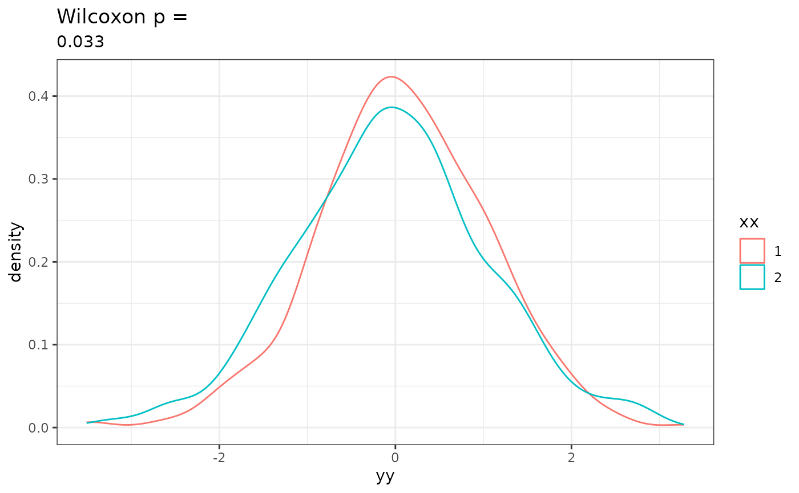
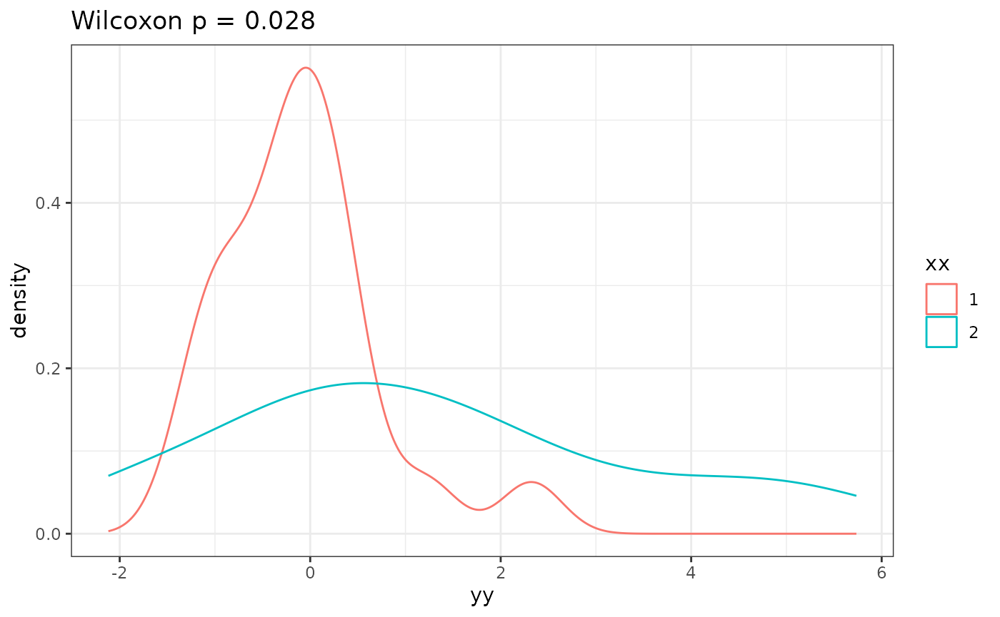

# Testing for normality? Don't bother

A better, less clickbait-y, longer title: **Robust testing and standard
errors as an alternative to making false assumptions**

In teaching at EBAME this year, I talked about how I strongly prefer
“parametric tests” (like t-tests, ANOVA, linear regression, and radEmu)
to “non-parametric tests” (like Wilcoxon/Mann-Whitney, Kruskal–Wallis,
Spearman rank, and PERMAOVA). Participants naturally asked for more
resources and justification for this (surprisingly controversial!)
viewpoint, inspiring this post.

## The smear campaign against “parametric tests”

**Fact:** t-tests, linear regression, and Poisson regression can be used
even if your data are not normally distributed or Poisson distributed.

So,

- You do not need normally distributed data to perform a t-test
- You do not need normally distributed, homoskedastic errors to fit,
  interpret and test hypotheses about linear regression (or ANOVA)
- You do not need Poisson distributed data to fit Poisson regression

and

- You do not need check (or formally test) that your data is normally
  distributed or homoskedastic before performing a t-test
  - (I recommend *not* assuming equality of variance in your t-test)
- You do not need check (or formally test) that your residuals are
  normally distributed or homoskedastic after fitting a linear
  regression or running an ANOVA
- You do not need check (or formally test) that your data is Poisson
  distributed or homoskedastic errors before fitting a Poisson
  regression

**However, you should use “robust standard errors” and “robust
hypothesis testing”** instead of “model-based standard errors” and
“robust hypothesis testing.” These are not returned by default in most
statistical software, but are implemented in a number of R packages.
I’ll explain them and show you my favourite software below.

Plotting your *data* is always useful – for quality control, but also
because being familiar with your data inspires rigorous science,
innovation, and critical thinking! – but a lot of the dogma of “checking
assumptions” is 40 years out of date.

Where did the misinformation about come from? Linear and Poisson
regression were first developed/invented/derived under distributional
assumptions in the early 20th century by the founders of modern
statistics. It wasn’t until the 1980’s that mathematical statisticians
showed that these assumptions weren’t needed. Some of the key papers
were TODO more + add links

- Robust standard errors:
  - White 1980…
- Consistency of M-estimation
  - …

Somehow, the implications of this work didn’t get distributed far beyond
PhDs in statistics, and many people who teach statistics continue to
perpetuate the idea that “t-tests and linear regression require
unreasonable assumptions.” It’s not true!!

Fact: If your data does follow the distributional assumptions, you can
apply the methods, of course! But I’ve never, ever analyzed data that is
normally or Poisson distributed, so this is a useless fact in practice,
in my view. See below for some comments on efficiency.

## Robust errors and tests

While parameter estimates obtained from linear and Poisson regression
are just fine, the default standard errors returned by statistical
software are not valid if the distributional assumptions don’t apply.
That is, usually,

- model-based standard errors underestimate the true variance in the
  estimate
- default p-values have inflated Type 1 error rates

Robust standard errors and robust testing provide a solution to both of
these problems. They are called “robust” because they are robust to the
distributional assumptions that are assumed by the default (model-based)
errors. Essentially, the curvature of the likelihood (which is what
determines the variance of an estimator) is estimated from the data
rather than imposed by a distributional model.

Here’s one way you can get robust standard errors and robust score
tests. For linear regression:

``` r

# remotes::install_github("statdivlab/raoBust")
library(tidyverse)
library(raoBust)
data("ddPCR")
ddPCR %>% 
  filter(SpecimenType == "Sputum") %>% 
  glm_test(formula = Value ~ Treatment, 
         data = ., family = gaussian(link = "identity"))
```

    ## 
    ## Call:
    ## glm(formula = Value ~ Treatment, data = ., family = gaussian(link = "identity"))
    ## 
    ## 
    ## Coefficient estimates:
    ##              Estimate Non-robust Std Error Robust Std Error Lower 95% CI
    ## (Intercept) 2031812.5             375828.2         400416.7      1247010
    ## Treatment   -583925.3             933285.6         616926.8     -1793079
    ##             Upper 95% CI Non-robust Wald p Robust Wald p Robust Score p
    ## (Intercept)    2816614.8      4.685446e-06  3.890383e-07   0.0001136016
    ## Treatment       625228.9      5.355927e-01  3.438902e-01   0.3493965173

Results interpretation: We estimate that the average bacterial
concentration in Sputum samples is $`5.8 \times 10^{5}`$ DNA copies/uL
lower in participants who received treatment compared to those who did
not receive treatment (95% CI: -1.8^{6} to 6.3^{5}, p=0.35).

For Poisson regression:

``` r

ddPCR %>% 
  filter(SpecimenType == "Sputum") %>% 
  glm_test(formula = Value ~ Treatment, 
           data = ., family = poisson(link = "log"))
```

    ## 
    ## Call:
    ## glm(formula = Value ~ Treatment, data = ., family = poisson(link = "log"))
    ## 
    ## 
    ## Coefficient estimates:
    ##               Estimate Non-robust Std Error Robust Std Error Lower 95% CI
    ## (Intercept) 14.5244388         0.0001260013        0.1970737    14.138181
    ## Treatment   -0.3388229         0.0003619206        0.3793513    -1.082338
    ##             Upper 95% CI Non-robust Wald p Robust Wald p Robust Score p
    ## (Intercept)    14.910696                 0     0.0000000   0.0001136021
    ## Treatment       0.404692                 0     0.3717694   0.3493965173

Results interpretation: We estimate the average bacterial concentration
in Sputum samples is $`e^{-0.3388229} \approx 0.71`$ times lower in
participants who received treatment compared to those who did not
receive treatment (95% CI: 0.34 to 1.5, $`p=`$ 0.35).

For logistic regression:

``` r

data("light_presence")
glm_test(formula = presence ~ light, data = light_presence, family = binomial(link = "logit"))
```

    ## 
    ## Call:
    ## glm(formula = presence ~ light, data = light_presence, family = binomial(link = "logit"))
    ## 
    ## 
    ## Coefficient estimates:
    ##              Estimate Non-robust Std Error Robust Std Error Lower 95% CI
    ## (Intercept)  20.56607             3964.631     7.222006e-09     20.56607
    ## lightLL     -20.74839             3964.631     6.260623e-01    -21.97545
    ##             Upper 95% CI Non-robust Wald p Robust Wald p Robust Score p
    ## (Intercept)     20.56607         0.9958611             0   5.465931e-06
    ## lightLL        -19.52133         0.9958244             0   3.327047e-03

Results interpretation: We estimate that the odds of detecting COG 4251
is $`e^{-20.74839} \approx 10^{-9}`$ times lower in genomes recovered
from low light environments compared to genomes recovered from high
light environments (95% CI for odds ratio: 2.9^{-10} to 3.3^{-9}, $`p=`$
0.0033)

My amazing team built `raoBust` because we kept seeing that *robust
score tests* had better error rates than *robust Wald tests*, and
(shockingly!!) we couldn’t find any software implementing robust score
tests – even for simple cases! So, we built one! (Let us know if you
have questions or requests for `raoBust`.)

Other packages R that provide robust standard errors include:
`sandwich`, `rigr`, others TODO… These give robust Wald tests – far
better than model-based testing, but not as good as robust score
testing, in my experience.

## Why don’t I like non-parametric tests

I like people who perform non-parametric tests (or, most of them!)… but
I generally discourage the use of non-parametric tests for the following
reasons

- There is no interpretable parameter
- They generally test hypotheses that are uninterpretable, and that I
  don’t care about.

I’m not going to go through every single non-parametric test, but here’s
one example that illustrates my issue.

The null hypothesis of the Wilcoxon test is that the distribution of the
outcome is the same across the two groups (not, as is commonly though,
that the medians are equal). This is a *much* stronger null hypothesis
than just equality of means! Even the tiniest, most biologically
uninteresting difference in the distribution (e.g., observations occur
between 0.60 and 0.61 with probability 0.01 in one group, and 0.011 in
the other) satisfies the alternative hypothesis. Pfffft - who cares?!
Not me. That’s not an interesting nor interpretable hypothesis, in my
view.

Furthermore, let’s look at the following dataset:

``` r

set.seed(66)
nn <- 500
a1 <- rnorm(nn, 0, 1)
a2 <- rnorm(nn, 0, 1.1)
signif(wilcox.test(a1, a2)$p.value, 2)
```

    ## [1] 0.033

p \< 0.05, how exciting! Let’s look at how much the distributions
differ:

``` r

tibble("yy" = c(a1, a2), "xx" = rep(c("1", "2"), each = nn)) %>% 
  ggplot(aes(x = yy, col = xx)) + 
  geom_density() +
  theme_bw() +
  ggtitle(paste0("Wilcoxon p = "), signif(wilcox.test(a1, a2)$p.value, 2))
```



Is that a difference you care about? Personally, I’m not very interested
in a difference like this.

Nothing has gone “wrong” here – the null is false (the distributions
truly differ!), and the test was rejected… I just don’t care.

Now let’s consider another case:

``` r

set.seed(66)
nn <- 20
b1 <- rnorm(nn, 0, 1)
b2 <- rnorm(nn, 1, 2)
signif(wilcox.test(b1, b2)$p.value, 2)
```

    ## [1] 0.028

Again, how exciting!! Is this a large difference in the distributions?

``` r

tibble("yy" = c(b1, b2), "xx" = rep(c("1", "2"), each = nn)) %>% 
  ggplot(aes(x = yy, col = xx)) + 
  geom_density() +
  theme_bw() +
  ggtitle(paste0("Wilcoxon p = ", signif(wilcox.test(b1, b2)$p.value, 2)))
```



Woah, yeah!! That difference is huge and obvious.

So, how can you communicate that one difference is relatively large and
the other is relatively small – in a way consistent with “different”
according to your test. It’s not obvious, actually! The alternative
hypothesis includes groups that differ in their means, but also groups
that have the same mean but differ in their variances, but also groups
that have the same mean and variance but differ in their skew, and so
on.

In contrast, a t-test for equality of means has an obvious and
interpretable measure of effect size: the difference in the sample
means:

- Case A: Estimated difference in means: $`\bar{X}^1 - \bar{X}^2`$ =
  0.13, standard error in the estimate:
  $`\sqrt{\hat{\sigma}_1^2/n_1+\hat{\sigma}_2^2/n_2}`$ = 0.065
- Case B: Estimated difference in means: $`\bar{X}^1 - \bar{X}^2`$ =
  -1.3, standard error in the estimate:
  $`\sqrt{\hat{\sigma}_1^2/n_1+\hat{\sigma}_2^2/n_2}`$ = 0.53

The magnitude of the estimate is much larger in the second case – and
it’s one that I’d brag about in the abstract of my paper, as it captures
that there’s not only a significant different, but – more importantly –
a **large** difference, possibly one that’s biologically or clincially
relevant.

In summary, “parametric” tests don’t make parametric assumptions, and

- test a clear hypothesis – something interpretable
- have an interpretable underlying parameter, whose estimates I can
  report to communicate the magnitude of the effect size

## Some theory supporting these claims

I don’t know of a good textbook or paper that makes this point clearly
and well – especially in a way useful for microbial ecologists (my
target audience). (Maybe I’ll try to get this note published somewhere?)

But the math is straightforward and uses common tools in mathematical
statistics… In fact, I can prove them for you quickly here. I do this in
order to provide you with these results in a *transparent,
self-contained* manner.

### The validity of t-tests when the data are not normally distributed

Formal claim: If $`X_1^a, X_2^a, \ldots, X_{n_a}^a`$ are drawn
independently from *some* distribution with mean $`\mu_a`$ and
$`X_1^b, X_2^b, \ldots, X_{n_b}^b`$ are drawn independently from *some*
distribution with mean $`\mu_b`$. Let
$`\bar{X}^a = \frac{1}{n_a} \sum_{i=1}^{n_a} X_i`$ and
$`\hat{\sigma}_a`$ be the sample standard deviation in group a’s
observations, and likewise for
$`\bar{X}^b = \frac{1}{n_a} \sum_{i=1}^{n_a} X_i`$ and
$`\hat{\sigma}_b`$ . Then

- $`\bar{X}^b - \bar{X}^a`$ is an unbiased estimate of $`\mu_b - \mu_a`$
- If $`\mu_a = \mu_b`$ , then
  $`\Pr\left(|\bar{X}_b-\bar{X}_a|/\sqrt{\hat{\sigma}_a^2/n_a+\hat{\sigma}_b^2/n_b}>1.96\right)\approx 0.05`$,
  and this approximation becomes better and better as $`n_a`$ and
  $`n_b`$ get larger and larger. That is, a t-test with unequal
  variances controls Type 1 error rates.

The first claim follows from the definition of bias and linearity of
expectations. The second follows from the central limit theorem:
$`\bar{X^a}`$ is approximately normally distributed, and
$`\frac{\hat{\sigma^a}}{n_a}`$ is a consistent estimate of its variance.
Slutsky’s theorem + pivoting gives the result.

Point of emphasis – I did not assume that the $`X`$’s were normally
distributed!!

### The validity of linear regression when data are not normally distributed

Formal claim: Suppose we observe independent pairs $`(X_i, Y_i)`$ and
$`\text{mean }Y_i = \beta_0 + \beta_1 X_{i1} + \ldots, \beta_p X_{ip}.`$
Then

- $`\hat{\beta}_k`$ is an unbiased estimate of $`\beta_k`$
- If $`\beta_k = 0`$ then
  $`Pr(\frac{|\hat{\beta}_k|}{\text{robust std error in } \hat{\beta}_k} > 1.96) = 0.05`$

TODO(AW)

Point of emphasis – I did not assume that the $`Y`$’s were normally
distributed around their mean!

### The validity of Poisson regression when data are not Poisson distributed

TODO(AW)

## Responding to reviewers who insist on non-parametric tests

I’d probably respond with something like this:

“Please note that (1) the estimates we provided are consistent
(asymptotically unbiased) for their target parameters, (2) we reported
robust estimates of the standard deviation in the estimates, which do
not require parametric assumptions to be valid, and (3) we used robust
hypothesis tests to test our hypotheses, which also do not require
parametric assumptions to be valid. As a result, our estimates and tests
are valid even if our data does not follow a normal distribution (see,
e.g., Wakefield (year) Chapter TODO). Briefly, this is because the
central limit theorem gives us that means and M-estimators are normally
distributed, even if the data is not.”

I’ve found that people tend to back off when they realize they’re
talking with someone who knows their shit. Good luck – and feel free to
reach out to me by email if took this approach and you’d like me to look
over your reviewer response for correctness.

## Advanced: Asymptotic vs exact tests

It is absolutely true that these tests work “better” if the parametric
assumptions hold (though, they never do?). See that $`\approx`$ in the
t-test results?

TODO explain

Fun fact, even if data is not Poisson distributed, that test statistic
is never exact. Lol! It’s funny how that’s considered fine. But TODO
talk about efficiency…

## Resources / further reading

- Jon Wakefield’s book
- …?
- homework problems from vdV???
- how to prompt Claude to not bullshit you

## TODOs

Do some simulations eg with zero inflated negative binomial data. Show
how the dispersion parameter changes the accuracy of the test. Highlight
how the $`\approx`$ goes away as $`n`$ gets large.

### How to deal with cluster correlation in `raoBust`

How to generalized estimating equations to deal with cluster correlation

ie random effects without distributional assumptions

TODO AW debug this

``` r

# gee_test(formula = Value ~ Treatment + SpecimenType, data = ddPCR, family = poisson(link = "log"), id = Subject)
```
