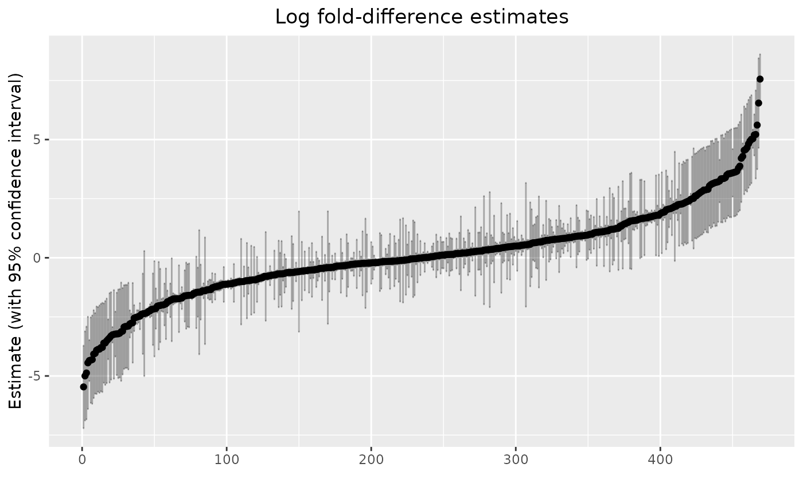

# EBAME: Differential Abundance with anvi'o ouput

## Background

This lab covers “differential abundance” using metagenomics data,
emphasizing using the outputs of anvi’o’s `anvi-estimate-scg-taxonomy`
function. You could probably adapt it to work with `anvi-profile-blitz`…
let us know if you want that!

It specifically covers the differential abundance method `radEmu`. We
like this method because it estimates changes in the “absolute
abundance” of microbial taxa, even without absolute quantification data.
Here, “absolute abundance” could be interpreted on the cell count, cell
concentration or DNA concentration scale. Yes! It’s true! (We talked
about this in lecture.)

We’ll illustrate its use on the the Healthy Dairy Workers dataset. We’re
interested in estimating changes in microbial abundances *before* versus
*after* commencing dairy work.

First let’s load libraries we’ll need. Install radEmu only if you don’t
already have it installed.

``` r

library(tidyverse)
if (!("radEmu" %in% row.names(installed.packages()))) {
  remotes::install_github("statdivlab/radEmu")
}
library(radEmu)
```

This is optional, but helpful to make some R packages be friends

``` r

select <- dplyr::select
```

## Downloading and reading in metadata

You can download the data
[here](https://github.com/statdivlab/presentations/tree/main/ebame10/afternoon_data).
(We’ve found [this website](https://download-directory.github.io/) to be
convenient for this purpose.)

The metadata is from SRA. Let’s read it in, and remove all columns that
are identical for all samples.

``` r

meta <- read.table("../data/hdw_metadata.tsv", header = TRUE, row.names = 1) %>% 
  as_tibble %>% 
  select(where(~ n_distinct(.) > 1))
head(meta)
```

    ## # A tibble: 6 × 4
    ##   sample_id host_subject_id collection_date replicate.number
    ##   <chr>     <chr>           <chr>                      <int>
    ## 1 S200_V00  S200            2018-03-15                     1
    ## 2 S200_V11  S200            2018-06-25                     1
    ## 3 S200_V22  S200            2018-10-11                     1
    ## 4 S200_V33  S200            2019-03-10                     1
    ## 5 S200_V44  S200            2020-11-09                     1
    ## 6 S201_V00  S201            2018-06-19                     1

We can see the study collected samples at different points in time
(`collection_date`) from different hosts (`host_subject_id`). How many
hosts do we have? And how many visits per host?

``` r

meta %>% 
  count(host_subject_id)
```

    ## # A tibble: 9 × 2
    ##   host_subject_id     n
    ##   <chr>           <int>
    ## 1 S200                5
    ## 2 S201                5
    ## 3 S207                4
    ## 4 S208                4
    ## 5 S210                4
    ## 6 S211                3
    ## 7 S212                3
    ## 8 S213                3
    ## 9 S214                4

## Creating and loading coverage data

To save time, we’re not going to work with the sequences directly – we
did that for you in advance. But how did I make the data we’re going to
give you? I did coassemblies within subject, then ran
`anvi-run-scg-taxonomy` on each of my contigs databases. From there, I
estimated the taxonomy as follows:

    for file in 03_CONTIGS/*-contigs.db; do
        base=$(basename "$file" -contigs.db)
        profile="06_MERGED/${base}/PROFILE.db"
        output="11_MGX_TAXONOMY/${base}_S2.txt"
        anvi-estimate-scg-taxonomy -c $file -p $profile --compute-scg-coverages --metagenome-mode -o $output --scg-name-for-metagenome-mode Ribosomal_S2
    done

You can see that these results went in a folder called
`11_MGX_TAXONOMY`.

To run `radEmu`, we need a table with samples in the rows, taxa in the
columns, and entries corresponding to the coverages of each taxon in
each sample. So, we have to turn this data into that form. We’re going
to aggregate at the species level (i.e., we will sum the coverage of
different strains within the same species).

Here’s how you can do that (you can go through this slowly in your own
time, and adapt it to your own data). We remove some negative control
data; it’s not useful for us here.

``` r

coverages_all <- list.files("../data/11_MGX_TAXONOMY/",pattern = "^S.*txt", full.names = T) %>% 
  lapply(FUN = read_tsv) %>% 
  bind_rows() %>%
  separate(scg_name, sep = "_", into = c("sample_profile_db", NA, "marker", "strain")) %>% 
  select(-percent_identity, -marker, -strain, -NEG_UWTrinh_BS_0001_F05, -NEG_UWTrinh_BS_0001_H05) %>% 
  pivot_longer(S200_V00:S214_V2B, 
               names_to = "sample_coverage", values_to = "coverage") %>% 
  filter(sample_profile_db == substr(sample_coverage,1,4)) %>%
  select(-sample_profile_db) %>% 
  rename(sample = sample_coverage) %>%
  group_by(sample, t_domain, t_phylum, t_class, t_order, t_family, t_genus, t_species) %>% 
  summarise(coverage = sum(coverage)) %>%
  ungroup() %>%
  mutate(taxa = paste0("d__", t_domain, ";p__", t_phylum, 
                       ";c__", t_class, ";o__",t_order,";f__",t_family,
                       ";g__", t_genus, ";s__",t_species)) %>% 
  mutate(sp_name = ifelse(t_species == "None", taxa, t_species) %>% str_replace(" ", "_"))

coverages <- coverages_all %>% 
  select(sample, coverage, sp_name) %>%
  pivot_wider(values_from = coverage, values_fill = 0, names_from = sp_name) %>%
  column_to_rownames(var="sample") 
```

How many species are there?

``` r

dim(coverages)
```

    ## [1]  35 472

Based on the dimensions of the metadata and coverage data, how are these
data tables related?

``` r

rownames(coverages)
```

    ##  [1] "S200_V00" "S200_V11" "S200_V22" "S200_V33" "S200_V44" "S201_V00"
    ##  [7] "S201_V11" "S201_V22" "S201_V33" "S201_V44" "S207_V0A" "S207_V0B"
    ## [13] "S207_V2A" "S207_V2B" "S208_V0A" "S208_V0B" "S208_V2A" "S208_V2B"
    ## [19] "S210_V0A" "S210_V0B" "S210_V1A" "S210_V1B" "S211_V00" "S211_V11"
    ## [25] "S211_V22" "S212_V00" "S212_V11" "S212_V22" "S213_V00" "S213_V11"
    ## [31] "S213_V22" "S214_V0A" "S214_V0B" "S214_V2A" "S214_V2B"

``` r

meta$sample_id
```

    ##  [1] "S200_V00" "S200_V11" "S200_V22" "S200_V33" "S200_V44" "S201_V00"
    ##  [7] "S201_V11" "S201_V22" "S201_V33" "S201_V44" "S207_V0A" "S207_V0B"
    ## [13] "S207_V2A" "S207_V2B" "S208_V0A" "S208_V0B" "S208_V2A" "S208_V2B"
    ## [19] "S210_V0A" "S210_V0B" "S210_V1A" "S210_V1B" "S211_V00" "S211_V11"
    ## [25] "S211_V22" "S212_V00" "S212_V11" "S212_V22" "S213_V00" "S213_V11"
    ## [31] "S213_V22" "S214_V0A" "S214_V0B" "S214_V2A" "S214_V2B"

To keep things simple, if there are technical replicates, we will retain
only one. For this, we will remove all samples labelled with a “B” at
the end.

``` r

coverages <- coverages[!endsWith(rownames(coverages), "B"), ]
meta <- meta %>%
  filter(!endsWith(sample_id,"B"))
```

Remember that we’re interested in estimating fold-changes in microbial
abundances before compared to after commencing dairy work. So, we will
create a variable called `exposed`, which will differentiate between
samples collected at baseline (FALSE: very first sample collected for
each host) and those collected after exposure (TRUE: samples collected
subsequently).

``` r

meta <- meta %>% 
  rownames_to_column("Rownames") %>%
  group_by(host_subject_id) %>%
  mutate(exposed = (min(collection_date) < collection_date)) %>%
  ungroup() %>%
  column_to_rownames(var="Rownames")
```

Check we have one exposed and the rest unexposed:

``` r

meta %>%
  group_by(host_subject_id) %>%
  count(exposed,host_subject_id)
```

    ## # A tibble: 18 × 3
    ## # Groups:   host_subject_id [9]
    ##    host_subject_id exposed     n
    ##    <chr>           <lgl>   <int>
    ##  1 S200            FALSE       1
    ##  2 S200            TRUE        4
    ##  3 S201            FALSE       1
    ##  4 S201            TRUE        4
    ##  5 S207            FALSE       1
    ##  6 S207            TRUE        1
    ##  7 S208            FALSE       1
    ##  8 S208            TRUE        1
    ##  9 S210            FALSE       1
    ## 10 S210            TRUE        1
    ## 11 S211            FALSE       1
    ## 12 S211            TRUE        2
    ## 13 S212            FALSE       1
    ## 14 S212            TRUE        2
    ## 15 S213            FALSE       1
    ## 16 S213            TRUE        2
    ## 17 S214            FALSE       1
    ## 18 S214            TRUE        1

So that `radEmu` knows now to connect the metadata and the coverage
data, we need to put the sample labels in the row names:

``` r

rownames(meta) <- meta$sample_id
```

Finally, to run radEmu, we need to confirm that all species are detected
in at least one sample. (Even if it was true at the beginning, we could
have taxa that were only in the removed samples.)

``` r

coverages <- coverages %>% select(where(~ sum(.x) != 0))
dim(coverages)
```

    ## [1]  27 469

27 samples, 469 species, woohoo!

Phew! That was a lot of data processing! That’s usually most of the
work!

Now, we can estimate fold-differences.

## Fitting a model

The function that we use to fit our model is called `emuFit`. Here’s the
arguments that we will use:

- `formula`: This is a formula telling `emuFit` what predictors to use.
  We are using just `exposed`, but your model could be much more
  complicated.
- `data`: The metadata table.
- `Y`: A matrix or data frame containing our observed abundance data.
  For us, it’s the coverage table. The rows give the observations
  (samples), and the columns give the categories (species).
- `cluster`: (Optional) If samples are correlated, the name of the
  ‘’groups’’ to which each sample belongs to, making them not
  independent. In our case, samples from the same host form clusters.

There’s one more important argument to know about:

- `run_score_tests`: (Optional) A logical value denoting whether or not
  to run score tests.

Say NO for now! We’ll come back to this.

Let’s see how the model fitting looks with the variables explained
above! This code should take less than a minute to run.

``` r

system.time({hdw_fit <- emuFit(formula = ~ exposed,
                  data = meta,
                  Y = coverages,
                  cluster = meta$host_subject_id,
                  run_score_tests = FALSE)})
```

    ##    user  system elapsed 
    ##   1.802   0.017   1.819

Let’s look at our results and talk through them together.

``` r

hdw_fit
```

    ## 
    ## Call:
    ## emuFit(Y = coverages, formula = ~exposed, data = meta, cluster = meta$host_subject_id, 
    ##     run_score_tests = FALSE)
    ## 
    ## 
    ## Coefficient estimates with the largest magnitudes:
    ##       covariate
    ## 4   exposedTRUE
    ## 395 exposedTRUE
    ## 55  exposedTRUE
    ## 3   exposedTRUE
    ## 101 exposedTRUE
    ## 50  exposedTRUE
    ## 353 exposedTRUE
    ## 11  exposedTRUE
    ## 273 exposedTRUE
    ## 56  exposedTRUE
    ## 433 exposedTRUE
    ## 15  exposedTRUE
    ## 95  exposedTRUE
    ## 160 exposedTRUE
    ## 77  exposedTRUE
    ## 448 exposedTRUE
    ## 232 exposedTRUE
    ## 173 exposedTRUE
    ## 290 exposedTRUE
    ## 109 exposedTRUE
    ##                                                                                                                  category
    ## 4                                                                                                 Bifidobacterium_bifidum
    ## 395                                                                                                 Dialister_sp002320515
    ## 55                                                                                                  Ruminococcus_B_gnavus
    ## 3                                                                                                Bifidobacterium_animalis
    ## 101                                                                                              Phocaeicola_massiliensis
    ## 50                     d__Bacteria;p__Bacillota_A;c__Clostridia;o__Lachnospirales;f__Lachnospiraceae;g__Merdisoma;s__None
    ## 353                                                                                                  CALXCQ01_sp944386835
    ## 11          d__Bacteria;p__Actinomycetota;c__Coriobacteriia;o__Coriobacteriales;f__Eggerthellaceae;g__Eggerthella;s__None
    ## 273                                                                                                   CAG-353_sp900066885
    ## 56                   d__Bacteria;p__Bacillota_A;c__Clostridia;o__Lachnospirales;f__Lachnospiraceae;g__Ventrimonas;s__None
    ## 433                                                                                             Angelakisella_sp900552845
    ## 15                d__Bacteria;p__Bacillota;c__Bacilli;o__Erysipelotrichales;f__Coprobacillaceae;g__Thomasclavelia;s__None
    ## 95                                                                                                   Megasphaera_elsdenii
    ## 160  d__Bacteria;p__Verrucomicrobiota;c__Verrucomicrobiae;o__Verrucomicrobiales;f__Akkermansiaceae;g__Akkermansia;s__None
    ## 77                                                                                                 Vescimonas_sp000435975
    ## 448                                                                                                 Merdousia_sp900548275
    ## 232                                                                                                  UMGS1901_sp900553755
    ## 173                       d__Bacteria;p__Bacillota;c__Bacilli;o__Lactobacillales;f__Lactobacillaceae;g__Weissella;s__None
    ## 290 d__Bacteria;p__Pseudomonadota;c__Gammaproteobacteria;o__Enterobacterales;f__Enterobacteriaceae;g__Citrobacter;s__None
    ## 109                                                                                                 Alistipes_onderdonkii
    ##     category_num  estimate        se     lower     upper
    ## 4              4  7.558651 0.5347847  6.510492  8.606810
    ## 395          395  6.544570 0.9669870  4.649311  8.439830
    ## 55            55  5.613179 0.9524578  3.746396  7.479962
    ## 3              3 -5.463178 0.8907873 -7.209089 -3.717267
    ## 101          101  5.215436 0.9514173  3.350693  7.080180
    ## 50            50  5.196918 0.4441021  4.326494  6.067343
    ## 353          353  5.032484 0.1982493  4.643922  5.421045
    ## 11            11  5.015379 0.9507151  3.152012  6.878747
    ## 273          273 -4.997699 0.9625110 -6.884186 -3.111212
    ## 56            56  4.936816 0.9503985  3.074069  6.799563
    ## 433          433 -4.873355 1.0008124 -6.834911 -2.911798
    ## 15            15  4.820096 0.9498799  2.958365  6.681826
    ## 95            95  4.657158 0.9490467  2.797061  6.517256
    ## 160          160  4.580213 0.8838203  2.847957  6.312469
    ## 77            77  4.545697 0.9483934  2.686880  6.404514
    ## 448          448 -4.444996 0.9952876 -6.395723 -2.494268
    ## 232          232 -4.347533 0.4432158 -5.216220 -3.478846
    ## 173          173 -4.329899 0.9239539 -6.140815 -2.518983
    ## 290          290 -4.307836 0.9534645 -6.176592 -2.439080
    ## 109          109  4.290305 0.2800716  3.741375  4.839235

    ## To obtain the entire coefficient table, use the command `emuFit_object$coef`.

The printed output is sorted by the largest estimated effect sizes (fold
differences), but how do we look at a specific species? The way to
access estimated coefficients and confidence intervals from the model is
with `hdw_fit$coef`. Let’s look at one:

``` r

hdw_fit$coef[52, ] 
```

    ##      covariate                   category category_num estimate         se
    ## 52 exposedTRUE Oliverpabstia_intestinalis           52 2.411388 0.06976821
    ##       lower    upper score_stat pval
    ## 52 2.274645 2.548132         NA   NA

## Interpreting the results

Let’s interpret these results! Here’s three equivalent interpretations:

- We estimate that the average abundance of Oliverpabstia_intestinalis
  in metagenomes is 11 times greater after commencing dairy work, when
  compared to the typical fold-differences in the average abundance of
  taxa across these visits. (Yep – that’s a *ratio* of *ratios*.)

&nbsp;

- We estimate that the log-fold difference in the average abundance of
  Oliverpabstia_intestinalis in metagenomes from visits post and prior
  exposure is 2.4 greater than the typical log-fold difference in the
  average abundance of taxa across these groups. (That’s a *difference*
  in *differences*.)

- Under the assumption that most taxa do not differ in average abundance
  between visits post and prior exposure, we estimate that the abundance
  of Oliverpabstia_intestinalis in metagenomes from post exposure visits
  is 11 times greater than prior exposure visits.

By default `radEmu` compares the log fold difference in one taxon to the
*typical* (approximately the median) log fold difference in all taxa.
However, `radEmu` can estimate other types of parameters. For example,
we can compare log fold differences to the log fold difference for a
specific (or reference) taxon. [This
vignette](https://statdivlab.github.io/radEmu/articles/radEmu_with_reference_taxon.html)
shows you how to modify your code to use a reference taxon.

**Please take the time to interpret your estimates, don’t just report
p-values.**

Ok, that’s one taxon. Let’s look at our results.

``` r

hdw_fit$coef %>% 
  arrange(estimate) %>%
  mutate(order = 1:n()) %>%
  ggplot(aes(x = order, y = estimate)) + 
  geom_point() + 
  geom_errorbar(aes(ymin = lower, ymax = upper), alpha = 0.3) + 
  labs(x = "", y = "Estimate (with 95% confidence interval)") + 
  ggtitle("Log fold-difference estimates") + 
  theme(plot.title = element_text(hjust = 0.5))
```



Here we can see the distribution of log fold-difference estimates from
our model, as well as 95% confidence intervals.

### Is this even reasonable?

A quick check…

``` r

max(hdw_fit$coef$estimate)
```

    ## [1] 7.558651

``` r

exp(max(hdw_fit$coef$estimate))
```

    ## [1] 1917.257

``` r

largest_diff <- hdw_fit$coef %>% 
  tibble %>% 
  filter(abs(estimate) == max(abs(estimate))) %>% 
  pull(category)
meta %>% 
  add_column(coverage = coverages[[largest_diff]]) %>% 
  select(sample_id, exposed, coverage)
```

    ##    sample_id exposed  coverage
    ## 1   S200_V00   FALSE   0.00000
    ## 2   S200_V11    TRUE  66.49854
    ## 3   S200_V22    TRUE 252.01276
    ## 4   S200_V33    TRUE 244.21329
    ## 5   S200_V44    TRUE   0.00000
    ## 6   S201_V00   FALSE   0.00000
    ## 7   S201_V11    TRUE   0.00000
    ## 8   S201_V22    TRUE   0.00000
    ## 9   S201_V33    TRUE   0.00000
    ## 10  S201_V44    TRUE   0.00000
    ## 11  S207_V0A   FALSE   0.00000
    ## 12  S207_V2A    TRUE   0.00000
    ## 13  S208_V0A   FALSE   0.00000
    ## 14  S208_V2A    TRUE   0.00000
    ## 15  S210_V0A   FALSE   0.00000
    ## 16  S210_V1A    TRUE   0.00000
    ## 17  S211_V00   FALSE   0.00000
    ## 18  S211_V11    TRUE 363.30792
    ## 19  S211_V22    TRUE 192.85163
    ## 20  S212_V00   FALSE   0.00000
    ## 21  S212_V11    TRUE   0.00000
    ## 22  S212_V22    TRUE 259.47017
    ## 23  S213_V00   FALSE   0.00000
    ## 24  S213_V11    TRUE   0.00000
    ## 25  S213_V22    TRUE   0.00000
    ## 26  S214_V0A   FALSE   0.00000
    ## 27  S214_V2A    TRUE   0.00000

## Hypothesis tests and p-values

Now, let’s talk about testing the null hypothesis that a species doesn’t
differ in its average abundance before vs after exposure. While its
tempting to use the confidence intervals to just say “p\<0.05” or “not
p\<0.05”, there’s a MUCH more reliable way. Robust score tests are the
reliable option – but they also take some time.

Let’s start by getting one p-value, then get them all.

To set up this test, we can again run `emuFit`, giving it the fitted
values that it has already found:

- `formula`, `data` and `Y` are as before
- `hdw_fit` is our previous fitted object (the output of `emuFit`)
- `test_kj` a data frame listing the indices of the parameters (in
  `hdw_fit$B`) that we want to test.

This should take about a minute to run on the RStudio server.

``` r

taxa_to_test <- c(134, 372)
covariate_to_test <- which("exposedTRUE" == hdw_fit$B %>% rownames)
two_robust_score_tests <- emuFit(formula = ~ exposed,
                                 data = meta,
                                 Y = coverages,
                                 cluster = meta$host_subject_id,
                                 # we already have hdw_fit, don't recompute this 
                                 fitted_model = hdw_fit,
                                 refit = FALSE, 
                                 test_kj = data.frame(k = covariate_to_test,
                                                      j = taxa_to_test),
                                 # have it tell you when it runs score tests
                                 verbose = TRUE, 
                                 # don't need to re-compute confidence intervals
                                 compute_cis = FALSE) 
```

Let’s take a look at the test output.

``` r

two_robust_score_tests$coef[taxa_to_test[1], "pval"]
```

    ## [1] 0.2155614

``` r

hdw_fit$coef[taxa_to_test, ]
```

    ##       covariate                category category_num  estimate        se
    ## 134 exposedTRUE Clostridium_sp900543325          134 -2.158088 1.0303187
    ## 372 exposedTRUE Clostridium_sp000435835          372  2.298507 0.9054655
    ##          lower      upper score_stat pval
    ## 134 -4.1774753 -0.1387001         NA   NA
    ## 372  0.5238273  4.0731869         NA   NA

We do not have strong statistical evidence to conclude the
fold-difference in abundance of these two taxa before and after exposure
is any different than the typical fold-difference. Here’s an example
interpretation appropriate for a paper

We estimate that the average abundance of Clostridium_sp900543325 in
metagenomes is 8.7 times greater *before* commencing dairy work, when
compared to the typical fold-differences in the average abundance of
taxa across these visits (95% CI 1.1–65; \$p = \$0.22).

In many data analyses, we’d like to run tests for all taxa that we have
measured. We could run robust score tests for every taxon in this
analysis, but it will take a long time to run all tests serially. They
can easily be run in parallel on a computing cluster (for example, if
you are in a VM!).

We show you how this might look in the following chunk. There’s a full
vignette
[here](https://statdivlab.github.io/radEmu/articles/parallel_radEmu.html).

DO NOT RUN THIS UNLESS YOU HAVE THE TIME AND COMPUTING RESOURCES!

``` r

ncores = parallel::detectCores() - 1
emuTest <- function(category) {
  score_res <- emuFit(formula = ~ exposed,
                       data = meta,
                       fitted_model = hdw_fit,
                       refit = FALSE,
                       cluster = meta$host_subject_id,
                       test_kj = data.frame(k = covariate_to_test, 
                                            j = category), 
                       Y = coverages)
  return(score_res)
}
if (.Platform$OS.type != "windows" & !identical(Sys.getenv("GITHUB_ACTIONS"), "true")) {
  # run if we are on a Mac or Linux machine
  score_res <- parallel::mclapply(1:ncol(coverages),
                      emuTest,
                      mc.cores = ncores)
} else {
  # don't run if we are on a Windows machine, or if testing with GitHub actions
  # You can do it! You just would need a different setup. Please reach out!
  score_res <- NULL
}

if (!is.null(score_res)) {
  c(score_res[[1]]$coef$pval[1], ## robust score test p-value for the first taxon
  score_res[[2]]$coef$pval[2]) ## robust score test p-value for the second taxon
}

if (!is.null(score_res)) {
  full_score <- sapply(1:length(score_res), 
                       function(x) score_res[[x]]$coef$score_stat[x])
  full_pval <- sapply(1:length(score_res), 
                      function(x) score_res[[x]]$coef$pval[x])
  full_coef <- hdw_fit$coef %>%
    select(-score_stat, -pval) %>%
    filter(category_num %in% 1:ncol(coverages)) %>%
    mutate(score_stat = full_score,
           pval = full_pval)
  full_coef
}
```

By the way – running this many tests is quite reasonable, but the
computation time increases as the number of predictors and number of
taxa increases. When you need it, the package `fastEmu` will be ready
for you \<3 We recommend using `fastEmu` over `radEmu` when running
differential abundance analyses for very large data sets. That said, you
do need to choose a reference set to use `fastEmu`, which makes the
interpretation of parameter estimates less intuitive than for `radEmu`.
If you find that `radEmu` is taking too long for your differential
abundance analysis, consider trying `fastEmu`!

## A quick constrast with other methods

`radEmu` isn’t the only differential abundance method. Some other
popular alternatives include `ALDEx2`, `ANCOM-BC2`, and `DESeq2`. Each
of these methods (and the many differential abundance methods that we
didn’t consider here) have pros and cons. Here’s a list of our opinions
on these methods. **These critiques are data-driven, but definitely
reflect our bias.**

- `radEmu`
  - pros: low bias, has Type I error rate control in all settings that
    we tested, handles sparsity well
  - cons: robust score tests are slow, especially in data sets with a
    large number of categories (taxa, genes, etc.)
- `fastEmu`
  - pros: inherits `radEmu` pros, is much faster than `radEmu`
    (especially with a large number of categories)
  - cons: an approximate method (rather than an exact method) with a
    less intuitive target parameter, still slower than several other
    methods
- `ALDEx2`
  - pros: very biased/variable estimates, has Type I error rate control
    in many situations, faster than `radEmu` to test all categories
  - cons: has very low power, handles zeroes poorly/weirdly
- `ANCOM-BC2`
  - pros: low bias, high power, faster than `radEmu` to test all
    categories
  - cons: terrible error rate control (i.e. not a valid test), can’t
    handle data separation (a common consequence of sparsity), relies on
    questionable sensitivity analysis
- `DESeq2`
  - pros: very biased/variable estimates, faster than `radEmu` to test
    all categories
  - cons: fails to control Type I error in some situations, tailored for
    RNA-seq data, not microbiome data, its own developers recommend
    against it for microbiome data
- `LinDA`
  - pros: faster than `radEmu` to test all categories, high power in
    some settings
  - cons: biased for largest effect sizes, fails to control Type I error
    in some situations (large sample sizes with sparse data), handles
    zeroes poorly/weirdly

Check out the documentation for each of these packages for more
information and more practice using them. Although this example uses a
single binary covariate, each of these methods can be run with more
complex regression models.
